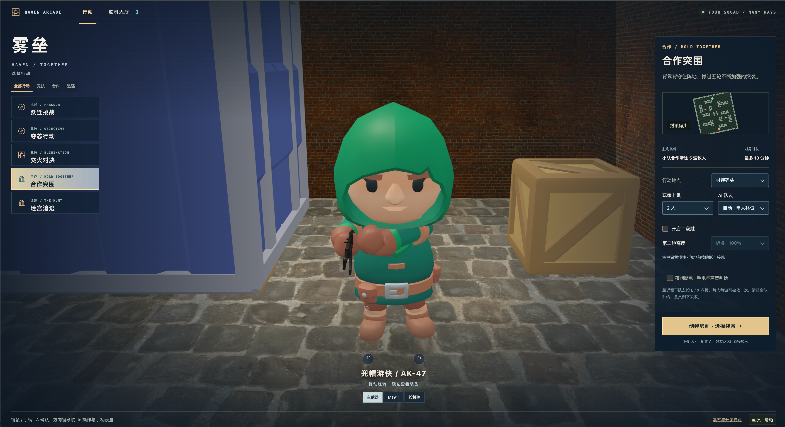

# Maze Chase · 雾垒

[中文](README.md) · [English](README.en.md)

Start a browser room and switch between competitive rounds, cooperative defense and maze pursuit. Maze Chase brings first-person combat, platforming, AI fill-ins and a map workshop into one lobby, with keyboard/mouse and standard-gamepad controls.

<p align="center"></p>

## Try it online

[GitHub Pages](https://haltcatch.github.io/maze-chase/) · Solo parkour in the browser; multiplayer requires the Node.js server.

## Features

- Parkour: cross platforms, bridges and obstacles, collect coins and compete for the lead.
- Objective mode: take the central core, break through the defense and deliver it.
- Skirmish and gun game: cover-based firefights, elimination scoring and weapon progression.
- Cooperative defense: survive five attack waves, revive teammates and resupply between waves.
- Maze pursuit: activate switches and escape, or hunt the runners before they reach the exit.
- Real-time play: Colyseus rooms, authoritative server state, client movement prediction and reconnection.
- Shared physics: Babylon.js rendering and Havok collision, with map editing and character/equipment previews.

## Quick start

Node.js 24.12 or later, npm and a WebGL-capable browser.

```sh
npm ci
npm run build
HOST=127.0.0.1 PORT=8080 npm start
```

## Configuration

| Setting | Purpose |
| --- | --- |
| `HOST / PORT` | Server bind address and port; the example uses `127.0.0.1:8080`. |
| `PUBLIC_ORIGIN` | Actual browser origin behind a reverse proxy, used for connection-origin checks. |

## Usage

Open `http://localhost:8080`, choose an action and map, create a room and let friends join from the lobby. A multiplayer reverse proxy must support WebSocket. Use WASD to move, the mouse to aim and Space to jump; the in-game menu lists the complete keyboard and gamepad controls.

## Project structure

- `src/client/` — Lobby, rendering, audio and controls
- `src/server/` — Rooms, game rules and AI
- `src/content/` — Maps and scene definitions
- `src/shared/` — Shared protocol and rules

## License

[PolyForm Noncommercial 1.0.0](LICENSE). See [LICENSE_SCOPE.md](LICENSE_SCOPE.md) for the scope of original material and third-party components, and the accompanying notices for third-party copyrights and licenses.
