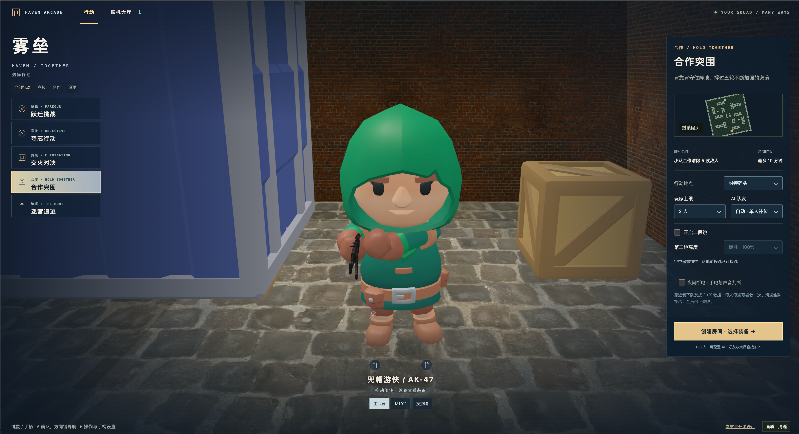

# Maze Chase · 雾垒

[中文](README.md) · [English](README.en.md)

在浏览器里开一间房，和朋友来一局竞技、合作或迷宫追逃。Maze Chase 将第一人称战斗、平台跳跃、AI 补位与地图工坊放在同一个大厅，支持键鼠和标准手柄。

<p align="center"></p>

## 在线体验

[GitHub Pages](https://haltcatch.github.io/maze-chase/) · 直接体验单人跑酷；多人模式按下方步骤自托管。

## 功能

- 跃迁挑战：穿越平台、桥梁与机关，收集金币并争夺名次。
- 夺芯行动：争夺中央核心，突破防线并完成交付。
- 交火对决与枪械进阶：掩体对抗、淘汰计分与分阶段武器升级。
- 合作突围：抵御五波突袭，救援倒下的队友，波次间补给。
- 迷宫追逃：开启电闸寻找出口，或扮演追逐者拦截逃生。
- 实时联机：Colyseus 房间、服务器权威状态、客户端移动预测与重连。
- 共享物理：Babylon.js 渲染与 Havok 碰撞，配合地图编辑、角色与装备预览。

## 快速开始

Node.js 24.12 或更高版本，npm，支持 WebGL 的浏览器。

```sh
npm ci
npm run build
HOST=127.0.0.1 PORT=8080 npm start
```

## 配置

| 配置项 | 说明 |
| --- | --- |
| `HOST / PORT` | 服务监听地址与端口；示例使用 `127.0.0.1:8080`。 |
| `PUBLIC_ORIGIN` | 反向代理后的实际浏览器来源，用于连接来源校验。 |

## 使用

打开 `http://localhost:8080`，选择行动与地图，创建房间后让朋友从大厅加入。多人部署的反向代理需要支持 WebSocket。键鼠操作使用 WASD 移动、鼠标瞄准、空格跳跃；完整键位和手柄设置见游戏内菜单。

## 项目结构

- `src/client/` — 大厅、渲染、音效与控制器
- `src/server/` — 房间、玩法与 AI
- `src/content/` — 地图与场景定义
- `src/shared/` — 共享协议与规则

## 许可

[PolyForm Noncommercial 1.0.0](LICENSE)。原创部分与第三方组件的适用范围见 [LICENSE_SCOPE.md](LICENSE_SCOPE.md)；各第三方版权和许可见相应声明文件。
